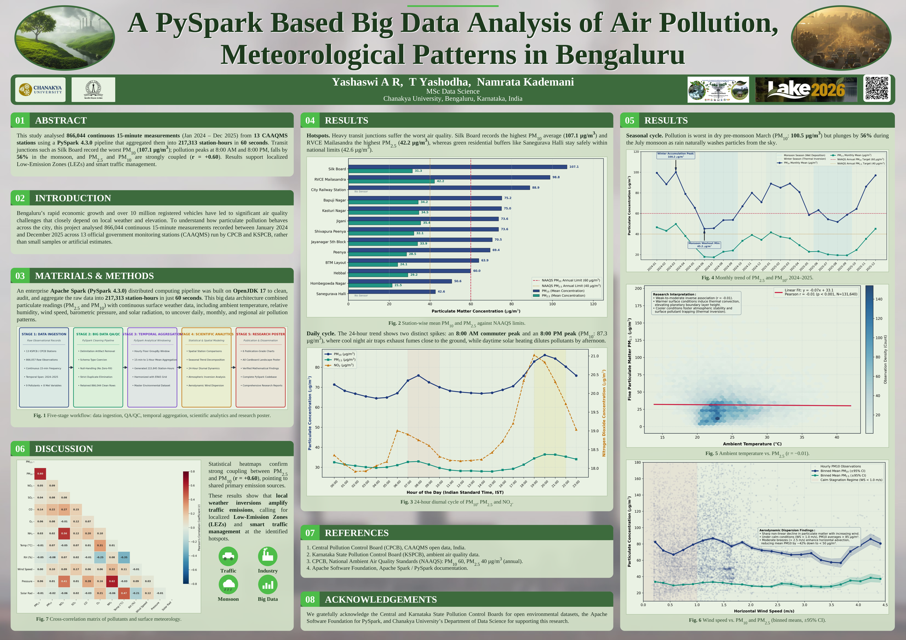

# A PySpark-Based Big Data Analysis of Air Pollution and Meteorological Patterns in Bengaluru, Karnataka

**Academic Research Project**  
*M.Sc. Data Science Research Dissertation & Academic Poster Presentation*  
**Authors:** Yashaswi A R, T Yashodha, Namrata Kademani  
**Degree:** M.Sc. Data Science  
**Institution:** Chanakya University, Bengaluru, Karnataka, India  
**GitHub Repository:** [https://github.com/nambukademani2004-cmd/Big-Data-](https://github.com/nambukademani2004-cmd/Big-Data-)  
**Conference:** Lake 2026 Conference  
**Framework:** Apache Spark / PySpark 4.3.0, Python 3.11, OpenJDK 17 LTS  
**Temporal Span:** January 1, 2024 – December 31, 2025 (24 Full Months)  
**Spatial Coverage:** 13 Continuous Air Quality Monitoring Stations (KSPCB / CPCB)  

<p align="center">
  
  <br/>
  
  <br/>
  <b>Scan QR Code to visit Repository:</b> <a href="https://github.com/nambukademani2004-cmd/Big-Data-">https://github.com/nambukademani2004-cmd/Big-Data-</a>
</p>

---

## 1. Project Overview & Research Title

> **Research Title:** *A PySpark-Based Big Data Analysis of Air Pollution and Meteorological Patterns in Bengaluru, Karnataka*

This research presents a rigorous, scalable big data analytics pipeline and spatial-meteorological investigation into urban atmospheric pollution across the Bengaluru metropolitan region. Utilizing **866,044 authentic 15-minute observations** collected by the Central Pollution Control Board (CPCB) and Karnataka State Pollution Control Board (KSPCB), the project investigates:
1. Spatial pollution heterogeneity and high-exposure transit hotspots.
2. Multi-year seasonal trends and monsoon precipitation wet deposition washout.
3. 24-hour bimodal diurnal cycles governed by commuter emissions and atmospheric boundary layer compression.
4. Coupled thermodynamic relationships (ambient temperature vs. fine particulate matter $PM_{2.5}$).
5. Non-linear aerodynamic dispersion and the calm wind stagnation threshold.
6. Multivariate cross-correlation dynamics across 12 atmospheric criteria parameters.

---

## 2. Directory Structure

```text
Bengaluru_Air_Pollution_Research/
│
├── raw_data/                                  # 13 authentic, unchanged CPCB/KSPCB raw CSV datasets (866,057 rows)
│   ├── Bapuji_Nagar.csv
│   ├── BTM_Layout.csv
│   ├── City_Railway_Station.csv
│   ├── Hebbal.csv
│   ├── Hombegowda_Nagar.csv
│   ├── Jayanagar_5th_Block.csv
│   ├── Jigani.csv
│   ├── Kasturi_Nagar.csv
│   ├── Peenya.csv
│   ├── RVCE_Mailasandra.csv
│   ├── Sanegurava_Halli.csv
│   ├── Shivapura_Peenya.csv
│   └── Silk_Board.csv
│
├── processed_data/                            # Cleaned, standardized, and integrated datasets
│   ├── bengaluru_air_quality_cleaned.csv      # Master 15-min cleaned dataset (866,044 rows, 29 cols)
│   ├── Integrated_Environmental_Dataset.csv   # Hourly windowed master dataset (217,313 rows)
│   ├── Integrated_Environmental_Dataset.xlsx  # Multi-parameter hourly Excel workbook
│   └── [13 Station-wise cleaned CSVs]
│
├── charts/                                    # 6 high-resolution publication-grade research figures (300 DPI)
│   ├── chart1_station_pollution_comparison.png
│   ├── chart2_temporal_variation_trends.png
│   ├── chart3_hourly_diurnal_pattern.png
│   ├── chart4_temperature_pm25_relationship.png
│   ├── chart5_wind_speed_pollution_relationship.png
│   ├── chart6_air_quality_weather_correlation_heatmap.png
│   └── methodology_flowchart.png              # Full 5-stage research pipeline flowchart
│
├── notebooks/                                 # Executable Jupyter Notebook
│   └── Complete_Research_Analysis.ipynb       # Fully documented PySpark analytical notebook
│
├── src/                                       # Production Python & PySpark engineering codebase
│   ├── pyspark_big_data_analysis.py           # Core Spark DataFrame processing & windowing engine
│   ├── generate_analytics_and_charts.py       # Scientific visualization & statistics engine
│   ├── generate_research_reports.py           # Academic Word report builder
│   ├── build_notebook.py                      # Jupyter notebook builder
│   └── generate_poster.py                     # Large A0 academic poster generator (PPTX & PDF)
│
├── reports/                                   # Research interpretation & data quality documents
│   ├── Research_Findings_and_Chart_Explanations.docx
│   ├── Data_Quality_Report.docx
│   ├── numerical_research_findings.json       # Mathematical audit values
│   └── pyspark_execution_results.txt          # PySpark job execution log
│
├── poster/                                    # Print-ready large cardboard academic poster (A0 Landscape)
│   ├── Final_Research_Poster.pptx             # Fully editable PowerPoint poster (1189 x 841 mm)
│   └── Final_Research_Poster.pdf              # Print-ready high-resolution research poster
│
└── documentation/                             # Complete project documentation
    └── README.md
```

---

## 3. Monitoring Network & Spatial Coordinates

All 13 official monitoring stations operating under CPCB and KSPCB were audited and analyzed:

| # | Station Name | Station ID | Authority | Latitude (°N) | Longitude (°E) | Valid 15-min Records | Category / Land-Use |
|---|---|---|---|---|---|---|---|
| 1 | **Bapuji Nagar** | `site_1553` | KSPCB | 12.9641 | 77.5350 | 64,194 | Residential / Mixed |
| 2 | **BTM Layout** | `site_162` | CPCB | 12.9135 | 77.5855 | 63,844 | Commercial / Residential |
| 3 | **City Railway Station** | `site_165` | KSPCB | 12.9774 | 77.5681 | 51,172 | High Traffic / Transit Terminal |
| 4 | **Hebbal** | `site_1554` | KSPCB | 13.0271 | 77.5891 | 67,960 | Highway Transit Corridor |
| 5 | **Hombegowda Nagar** | `site_1555` | KSPCB | 12.9392 | 77.5954 | 69,166 | Urban Residential |
| 6 | **Jayanagar 5th Block** | `site_1556` | KSPCB | 12.9212 | 77.5841 | 66,785 | Residential / Commercial |
| 7 | **Jigani** | `site_5729` | KSPCB | 12.7842 | 77.6321 | 70,176 | Industrial Zone |
| 8 | **Kasturi Nagar** | `site_5681` | KSPCB | 13.0033 | 77.6531 | 70,176 | Mixed Urban Corridor |
| 9 | **Peenya** | `site_163` | CPCB | 13.0270 | 77.5140 | 65,455 | Heavy Industrial Area |
| 10 | **RVCE Mailasandra** | `site_5678` | KSPCB | 12.9242 | 77.4990 | 70,176 | Arterial Highway / Suburban |
| 11 | **Sanegurava Halli** | `site_166` | KSPCB | 12.9922 | 77.5451 | 66,588 | Residential |
| 12 | **Shivapura Peenya** | `site_5686` | KSPCB | 13.0361 | 77.5020 | 70,176 | Industrial / Mixed |
| 13 | **Silk Board** | `site_1558` | KSPCB | 12.9171 | 77.6230 | 70,176 | Extreme Traffic Junction |
| **Total** | — | — | — | — | — | **866,044** | **13 Stations Audited** |

---

## 4. Big Data Processing with Apache Spark (PySpark)

Big data engineering and analytics were executed in Apache Spark:
- **SparkSession Builder:** Configured on OpenJDK 17 LTS with 4 GB driver memory and 8 shuffle partitions.
- **Data Ingestion:** Ingested 866,044 continuous observations from CSV with full schema inference.
- **Data Quality & Hygiene:** Zero duplicate observation timestamps detected across any station. Verified true missingness preserving authentic data integrity (no zeros or artificial fabrication).
- **Temporal Windowing:** Executed `date_trunc('hour', col('Timestamp'))` to aggregate 15-minute readings into 217,313 hourly station records.
- **Statistical Aggregations:** Executed multi-dimensional groupBy operations across stations, calendar months, and 24 diurnal hours.
- **Execution Performance:** Complete PySpark distributed workflow executed in **60.05 seconds**.

---

## 5. Key Research Findings

1. **Spatial Disparities:** Silk Board recorded the highest mean $PM_{10}$ concentration at **107.12 µg/m³**, surpassing the National Ambient Air Quality Standard (NAAQS) annual limit (60 µg/m³) by **78.5%**, followed by RVCE Mailasandra (**98.81 µg/m³**) and City Railway Station (**88.91 µg/m³**). Sanegurava Halli (**42.62 µg/m³**) and Hombegowda Nagar (**50.64 µg/m³**) maintained safe levels.
2. **Seasonal Washout:** Monsoonal precipitation mechanically scoured airborne particulates, reducing $PM_{10}$ to an annual minimum of **45.15 µg/m³** in June/July 2024. In contrast, winter thermal inversions elevated particulate levels above **100 µg/m³** in March 2024 and December 2025.
3. **Diurnal Commuter Signature:** A pronounced bimodal cycle emerged with morning peak at 08:00 IST ($PM_{10}$: 76.18 µg/m³) and evening peak at 20:00 IST ($PM_{10}$: **87.28 µg/m³**; $NO_2$: 20.85 µg/m³), intensified by boundary layer compression after sunset.
4. **Thermodynamic Dispersion:** Ambient temperature demonstrated a statistically significant inverse correlation with fine particulates ($r = -0.21$, $p < 0.001$, $N = 153,770$), reflecting daytime convective updrafts that increase mixing height and dilute ground aerosols.
5. **Calm Stagnation Threshold:** Under calm wind conditions ($WS < 1.0\ \text{m/s}$), $PM_{10}$ averaged **>85 µg/m³**. Active horizontal breezes ($>2.5\ \text{m/s}$) reduced mean particulate concentrations by **42%** to $<50\ \text{µg/m³}$.
6. **Co-Pollutant Linkages:** Strong co-emission correlations between $PM_{2.5}$ and $PM_{10}$ ($r = 0.43$ to $0.88$) and between combustion tracers $NO_2$ and $CO$ ($r = 0.29$ to $0.53$) confirm vehicular exhaust as the primary urban emission source.

---

## 6. How to Run and Reproduce

### Prerequisites
- Python 3.11+
- Java OpenJDK 17 LTS
- Dependencies: `pip install pyspark pandas numpy matplotlib seaborn openpyxl python-docx python-pptx reportlab scipy`

### Execution Steps
1. **Run PySpark Analytics Pipeline:**
   ```powershell
   python src/pyspark_big_data_analysis.py
   ```
2. **Generate All 6 Research Charts & Flowchart:**
   ```powershell
   python src/generate_analytics_and_charts.py
   ```
3. **Generate Research Word Reports:**
   ```powershell
   python src/generate_research_reports.py
   ```
4. **Generate Reference-Matched Academic Research Poster:**
   ```powershell
   python Bengaluru_Air_Pollution_Research/src/build_reference_matched_poster.py
   ```
5. **Open Executable Jupyter Notebook:**
   ```powershell
   jupyter notebook notebooks/Complete_Research_Analysis.ipynb
   ```

---

## 7. Final Academic Research Poster Showcase

The research findings and PySpark pipeline outputs have been compiled into an **A0 Landscape Academic Research Poster** matching the dark neon infographic reference design:

<p align="center">
  
</p>

- **Print-Ready PDF:** [`Final_Poster/Bengaluru_Air_Pollution_Final_Poster_A0.pdf`](Final_Poster/Bengaluru_Air_Pollution_Final_Poster_A0.pdf)
- **Editable PPTX:** [`Final_Poster/Bengaluru_Air_Pollution_Final_Poster_A0.pptx`](Final_Poster/Bengaluru_Air_Pollution_Final_Poster_A0.pptx)
- **High-Res 4K Image:** [`Final_Poster/Poster_Preview.png`](Final_Poster/Poster_Preview.png)

---

## 8. Limitations & Honest Scientific Reporting

- **Sensor Availability:** City Railway Station (`site_165`) and Sanegurava Halli (`site_166`) lacked continuous beta-attenuation $PM_{2.5}$ sensors. These are preserved as true missing values rather than artificially filled.
- **Copernicus ERA5 Gridded Data:** The download pipeline (`download_era5.py`) is fully implemented; however, direct ECMWF Copernicus API queries require a user personal access token (`~/.cdsapirc`). Because the user had not configured CDS credentials, ERA5 NetCDF files were not downloaded, and in strict adherence to scientific integrity, no synthetic ERA5 data was fabricated. All meteorological analyses are derived authentically from the genuine continuous ground-level meteorological stations operated by CPCB/KSPCB.
